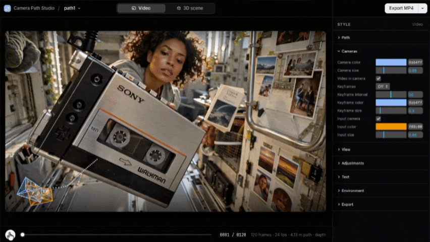

# Camera Path Studio

Turn an [Atlas](https://www.worldlabs.ai) export into a clean camera-path visual and export it as a video.

[](https://camera-path-studio.netlify.app)

**[camera-path-studio.netlify.app](https://camera-path-studio.netlify.app)**: runs in your browser, with nothing to install.



Drop in the export's `.zip`, pick a layout, adjust the look in the side panel, and export an MP4. It runs entirely in your browser, and nothing is uploaded anywhere.

**Three layouts**

- **Video**: the generated video full-frame, with the 3D camera path inset in a corner. The path ahead is dotted, the camera frustum shows the live frame, and the path fades where it passes behind a frame image.
- **3D scene**: the camera path inside a point cloud of the scene (built from the input photo's depth), with the video and input photo picture-in-picture (a small grid of photos when several are shown). A gentle wiggle helps the depth read.
- **Breakdown**: the input photos in a grid and the 3D camera path below them, in a column beside the video. The video keeps its full 1920×1080, so this layout is 2560×1080. It shows all of a take's input photos to start with.

## Two ways to run it

### In the browser

Open **https://camera-path-studio.netlify.app**, or put these files on any static host (Netlify, GitHub Pages, Vercel…) and open that. Then drop an Atlas export `.zip` onto the page.

- The `.zip` is unpacked in your browser and kept there, so your takes are still there next time. Nothing is uploaded.
- MP4s are encoded in the browser with WebCodecs. Use Chrome, Edge, Safari or a recent Firefox.

### Locally, with Python

This adds the **alpha .mov** export and lets you work straight from a folder of exports. You need **Python 3.10+** and, for video export, **[ffmpeg](https://ffmpeg.org/download.html)** on your PATH (`brew install ffmpeg` on macOS).

```bash
git clone https://github.com/icurtis1/camera-path-studio.git
cd camera-path-studio
python3 server.py --open
```

The `--open` flag opens http://127.0.0.1:8780 in your browser. Dropped `.zip` files are unpacked into `takes/` next to the server. To use a folder of exports you already have, pass it instead:

```bash
python3 server.py ~/path/to/exports --open
```

Every subfolder with a `scene.json` shows up in the **Take** menu.

## What's in an Atlas export

The studio reads the export folder as-is:

```
my-take/
├── scene.json        cameras for every output frame (+ the input photo's camera)
├── video.mp4         the generated video (optional; frames are used if it's missing)
├── inputs/           the input photo(s), each with a depth map (.exr) and confidence (.png)
└── outputs/          one image per generated frame
```

Only `scene.json` and the frames it lists are required. An export can have several input photos; their depth maps are used for the point cloud in the 3D scene layout.

## Using it

- **Take**: switch between takes, or import another `.zip`. You can also drag a `.zip` anywhere onto the page. To remove a take you imported, hover it in the menu and click the trash icon. That deletes it from your browser, or with the local server from the takes folder. Folders you pointed the server at yourself can't be removed from the page.
- **Layout**: switch between Video, 3D scene and Breakdown. Each layout keeps its own style.
- **Side panel**: Path, Cameras, View, Adjustments, Text, Environment and Export. The 3D scene layout also has **Output & input**, which shows, hides, moves or resizes the video and input-photo pictures; in Breakdown it shows or hides the input photos. Your settings are saved in your browser.
- **Several input photos**: when a take has more than one, **Cameras → Input images** sets how many are shown, starting from the first (1 by default; all of them in Breakdown). Each one gets its own camera, the point cloud is built from all of them, and the input picture in 3D scene becomes a small grid. **Environment → Point opacity** makes the point cloud see-through.
- **3D view**: in the Video layout that's the corner inset, and in Breakdown the panel under the input photos. Drag it to rotate, right-drag to pan, scroll to zoom. **Path → Show path** hides the inset if you only want the video. **View → Snap to angle** reframes it from a preset angle. **View → Follow camera** keeps the view on the moving camera as it plays, for scenes too big to see whole: you can still orbit and zoom around it, and turning it off brings the overview back. The framing is remembered per take.
- **Timeline**: <kbd>Space</kbd> plays or pauses, <kbd>←</kbd> <kbd>→</kbd> step one frame.

**Export**

- **Export MP4**: every frame at full quality (1920×1080, or 2560×1080 for Breakdown, with 2× supersampled 3D), encoded as H.264.
- **Export alpha .mov**: the path and overlays only, on a transparent background (ProRes 4444), for compositing in Premiere, Resolve or After Effects. This needs the local version, because browsers can't encode ProRes.
- **Snapshot**: the current frame as a PNG.

Exports download through your browser, into your Downloads folder (or wherever your browser saves files). With the local server, a copy also stays in the take's `exports/` folder.

## For scripts and agents

The page exposes a small handle, `window.studio`:

```js
await studio.ready;                    // a take is loaded
studio.setLayout('world');             // 'overlay' (Video), 'world' (3D scene) or 'breakdown'
studio.set('pathWidth', 8);            // any side-panel setting (keys are in BASE in app.js)
studio.setFrame(60);
const mp4 = await studio.exportVideo();          // downloads it; resolves to the saved copy's path (local) or file name
const mov = await studio.exportVideo({ alpha: true });   // local version only
const png = await studio.snapshot();
```

Open a specific take and layout with URL parameters: `http://127.0.0.1:8780/?take=my-take&layout=world`.

With the local server, these are the endpoints the page uses:

| Method | Path | Does |
| --- | --- | --- |
| GET | `/api/takes` | Lists takes and whether ffmpeg is available |
| POST | `/api/import?name=x.zip` | Body: a `.zip`. Unpacks it into the takes folder and returns `{ take }` |
| POST | `/api/export/start`, `/frame`, `/finish` | Collects PNG frames and encodes them with ffmpeg |
| POST | `/api/snapshot?take=…&name=…` | Body: a PNG. Saves it to `<take>/exports/` |
| POST | `/api/remove?take=…` | Deletes a take that was imported from a `.zip` |
| GET | `/data/<take>/…` | Files inside a take |

## Files

```
server.py    optional local server: serves the page and a takes folder, unpacks .zip imports, runs ffmpeg
index.html   page layout and styles
app.js       everything else: loading takes, the 3D scene (three.js), drawing, export, side panel
favicon.svg  site icon (+ PNG versions for Safari and older browsers)
docs/        the README's preview
```

three.js, lil-gui, fflate (unzipping) and mp4-muxer (MP4 files) load from a CDN, so there's no build step.

## Notes

- Camera poses are read in the `rub` convention used by three.js (+x right, +y up, the camera looks down −z), and `rdf` is converted. Quaternions are `[x, y, z, w]`.
- Depth is treated as planar z-depth in the scene's units, and distances are labelled in metres (`UNIT` in `app.js`).
- The local server only listens on `127.0.0.1`, so it isn't reachable from other machines.

## License

[MIT](LICENSE)
